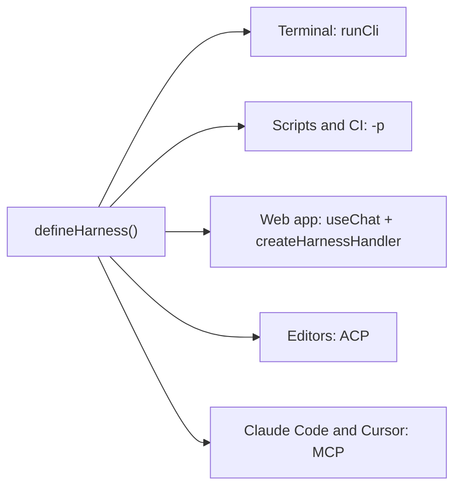

Less than a year ago, TanStack AI was a `chat()` function, four providers, and one promise: no lock-in, ever.

Today we're shipping 1.0, with stable core APIs and a new experimental agent harness. Your provider, your framework, your sandbox, and the wire protocol between them are still yours to pick. The promise held.

A lot happened between [the alpha](/blog/tanstack-ai-alpha-your-ai-your-way) and today. That `chat()` function grew into a toolkit for chat, tools, media, MCP, persistence, sandboxes, and agents, with 23 provider adapters and eight UI frameworks. More than 140 people helped build it.

We want you to be able to build the AI experience you actually want, whether that's a feature in an existing app, a product of your own, or a framework other people build on. That goes for developers writing every line themselves and people who'd rather tell a coding agent what they want to build.

Chat is one place to start, but it doesn't have to be the whole app. Put image generation in an editor, use voice as the interface, or build an agent that keeps working while you do something else. The pieces should grow with what you're building.

## What 1.0 Means

1.0 is our formal commitment to the APIs you build on.

The core APIs are stable and ready for production. The new harness APIs are experimental.

And here's the good news if you already run TanStack AI: **1.0 has no new concepts.** We removed every API that 0.x marked as deprecated, and every replacement already shipped in 0.x. If you kept up with the deprecation warnings, you're most of the way there.

Two things to know:

- **Upgrade everything together.** A 1.0 client needs a 1.0 server, so move your stable `@tanstack/ai*` packages at the same time. The experimental harness packages stay on 0.x.
- **The new agent harness is the one exception.** Its APIs are experimental. More on that at the end.

## How We Got Here

_Cue "Carry On Wayward Son" by Kansas, one last time._

- **December 2025:** [the alpha](/blog/tanstack-ai-alpha-your-ai-your-way) shipped `chat()`, four providers, isomorphic tools, and devtools. Two weeks later, [Alpha 2](/blog/tanstack-ai-alpha-2) brought every modality.
- **The winter of rewrites:** we [killed the `ai()` function](/blog/tanstack-ai-the-ai-function-postmortem) after eight days of work, and [split the adapters](/blog/tanstack-ai-why-we-split-the-adapters) into small, tree-shakable pieces.
- **Spring 2026:** [middleware](/blog/tanstack-ai-middleware), [realtime voice](/blog/tanstack-ai-realtime-voice-chat), [Code Mode](/blog/tanstack-ai-code-mode), [streaming structured output](/blog/streaming-structured-output), and [full AG-UI compliance](/blog/ag-ui-compliance).
- **June 2026:** [MCP, your way](/blog/your-mcp-your-way), [the Beta](/blog/tanstack-ai-beta), [AI Project of the Year](/blog/tanstack-open-source-awards-2026) at the Open Source Awards, and [coding agents in sandboxes](/blog/run-coding-agents-in-a-sandbox).
- **August 2026:** [the RC](/blog/tanstack-ai-rc), with the architecture locked in.
- **October 2026:** 1.0.

Here's how far that got us:

|                   | Alpha                        | 1.0                                                                       |
| ----------------- | ---------------------------- | ------------------------------------------------------------------------- |
| Provider adapters | 4                            | 23, plus `openaiCompatible` for any OpenAI-style API                      |
| UI frameworks     | React, Solid, and vanilla JS | React, Vue, Solid, Svelte, Preact, Angular, Octane, Remix, and vanilla JS |
| Coding agents     | None                         | Claude Code, Codex, OpenCode, Grok Build, and any ACP agent               |
| Sandbox providers | None                         | 11                                                                        |

Our end-to-end tests run on every pull request, checking provider adapters and tool execution flows against deterministic model fixtures, without live API calls.

## What Landed Since the RC

The RC locked the architecture, but we haven't been sitting still. Here's what's landed since then.

### Agents

- [Subagents](/ai/latest/docs/chat/subagents) in `chat()` and `useChat`: hand turns to a named child agent, such as a researcher or a writer, with typed input and limits.
- [`decide()`](/ai/latest/docs/evaluate/evaluate) for typed `choice`, `score`, and `boolean` decisions.
- [Portable Agent Skills](/ai/latest/docs/skills/agent-skills): any tool-calling model can load `SKILL.md` skills when it needs them.
- [Compaction](/ai/latest/docs/advanced/compaction) keeps long chats under the context limit, with native provider compaction where the provider has it.
- [Computer use](/ai/latest/docs/computer-use/computer-use): the model uses a web page from screenshots, and the same code runs on OpenAI and Anthropic.

### Models

- [`chat({ reasoning })`](/ai/latest/docs/chat/reasoning): one reasoning option that works the same on every provider and is typed per model.
- [Automatic prompt caching](/ai/latest/docs/advanced/prompt-caching), and [tools or system prompts that change mid-conversation](/ai/latest/docs/advanced/mid-conversation-changes) without losing the cache.
- `chat({ retry })` for rate-limited model calls.
- History that replays across models, so one conversation can move to another model.
- The [Files API](/ai/latest/docs/advanced/files-api) of each provider, behind one interface.

### Keys and sign-in

- [Bring your own key](/ai/latest/docs/advanced/byok), with `defineByok` and keyed adapters.
- Sign in with ChatGPT, GitHub Copilot, or OpenRouter, or use a Claude OAuth token, so users of a local app don't have to paste an API key.

### MCP

- [`createMCPServer`](/ai/latest/docs/mcp/server) serves your TanStack tools as an MCP server for Claude Desktop, Cursor, and any other MCP host.
- Tool filters, approvals, and task-based tools for MCP clients.
- [WebMCP](/ai/latest/docs/tools/webmcp) in both directions: browser agents call your client tools, and your chat uses the tools of a page.

### Providers, frameworks, and sandboxes

- New adapters: Cloudflare Workers AI and AI Gateway, Lovable AI Gateway, Azure OpenAI, World Labs Marble, TypeSafe, and Ollaya.
- [Remix 3](/ai/latest/docs/ui/remix) support, and devtools for Svelte.
- Five new [sandbox providers](/ai/latest/docs/sandbox/providers): Blaxel, Upstash Box, E2B, boxd, and Railway.

### Building and testing

- Typed, headless chat UI factories, with [custom adapters](/ai/latest/docs/ui/custom-adapters) for any framework.
- [`fakeText()`](/ai/latest/docs/advanced/testing) to test `chat()`, tools, and middleware with no network and no API key.
- [Agent Skills for your coding assistant](/ai/latest/docs/getting-started/agent-skills), so Claude Code or Cursor writes correct TanStack AI code for the version you installed.

## Docs, Rewritten for 1.0

We rewrote every hand-written docs page for 1.0.

Each page now opens with the problem and a setup that you can copy and run in a few minutes. The deep details moved to an Advanced part at the end, or to an advanced page next to it. Every adapter page uses the same order, so you can compare providers side by side.

New here? The [Quick Start](/ai/latest/docs/getting-started/quick-start) gives you a streaming chat in about five minutes.

## Upgrade From 0.x

For most apps, the upgrade is one codemod and a type check:

1. Run the codemod. It does the most common renames for you:

   ```bash
   npx jscodeshift \
     --parser=tsx \
     -t https://raw.githubusercontent.com/TanStack/ai/main/codemods/ag-ui-compliance/transform.ts \
     "src/**/*.{ts,tsx}"
   ```

2. Update your stable `@tanstack/ai*` packages to 1.0 at the same time. The experimental harness packages stay on 0.x. Remove `@tanstack/ai-react-ui`, `@tanstack/ai-solid-ui`, and `@tanstack/ai-vue-ui` if you use them. These three don't have 1.0 releases.
3. Run your type checker, and fix each error with the [upgrade guide](/ai/latest/docs/migration/v1).
4. If you keep data from 0.x (chats, runs, or files), do the saved-data steps in the guide before you deploy.

The changes that you are most likely to hit:

- `body` is now `forwardedProps`, and `conversationId` is now `threadId`. The codemod renames both.
- `threadId` is now required, in the browser and on the server. Neither side makes one for you. In the browser, pass a stable id for each conversation, such as the id from your route or your database. On the server, pass the id that the client sends:

  ```diff
    // In the browser
  - useChat({ connection })
  + useChat({ connection, threadId: chatId })

    // On the server
    const stream = chat({
      adapter: openaiText('gpt-6.1-sol'),
      messages: params.messages,
  -   conversationId: params.forwardedProps.conversationId,
  +   threadId: params.threadId,
    })
  ```

  The same goes for `ChatClient`, the generation hooks such as `useGenerateImage`, and the generation functions such as `generateImage()`. The codemod cannot add `threadId`, because it does not know your ids.

- `addToolApprovalResponse()` is gone. Resolve the `tool-approval` interrupt instead:

  ```diff
  - const { addToolApprovalResponse } = useChat({ connection, body: { userId } })
  - addToolApprovalResponse({ id, approved: true })
  + const { interrupts } = useChat({
  +   connection,
  +   threadId: chatId,
  +   forwardedProps: { userId },
  + })
  + const approval = interrupts.find((item) => item.kind === 'tool-approval')
  + if (approval?.kind === 'tool-approval') approval.resolveInterrupt(true)
  ```

- If you used `ai-react-ui`, `ai-solid-ui`, or `ai-vue-ui`, build your UI with `createChatHook` from `@tanstack/ai-react/ui`, `@tanstack/ai-solid/ui`, or `@tanstack/ai-vue/ui`.
- If you run your own server that streams to a TanStack AI client, stop sending `data: [DONE]`. End the run with a `RUN_FINISHED` event.

Passing the type check doesn't migrate stored conversations, runs, or files. Follow the saved-data steps in the guide before you deploy.

## One More Thing: The Agent Harness

`chat()` answers one request, which is great for a chat box.

A coding agent, a support bot, or a media studio needs more. It needs one conversation that stays open, takes new messages while it works, runs other agents, and survives a deploy.

So we built [`@tanstack/ai-harness`](/ai/latest/docs/harness/overview). You define a harness once, with the same options as `chat()`, and open a session for each conversation:

```ts
import { createHarnessHost, defineHarness } from '@tanstack/ai-harness'
import { openaiText } from '@tanstack/ai-openai'
import { memoryPersistence } from '@tanstack/ai-persistence'

const assistant = defineHarness({
  name: 'acme/assistant',
  adapter: openaiText('gpt-6.1-sol'),
  systemPrompts: ['You are a helpful travel agent.'],
})

const host = createHarnessHost({ persistence: memoryPersistence() })
const session = await host.open(assistant, { threadId: 'trip-1' })

const plan = session.send('Plan a three-day trip to Lisbon.')
plan.onEvent('TEXT_MESSAGE_CONTENT', ({ event }) => {
  process.stdout.write(event.delta)
})

// The user types while the agent works. A steer joins the running turn.
await session.send('Keep it under 500 euros.', { mode: 'steer' })
await plan
```

The events are standard AG-UI events. A steer joins the running turn before its next model call, or starts the next turn if the current one's already finished. A follow-up waits until the current work is done.

This example uses in-memory persistence. To recover after a restart, you'll need a durable store. There are still [recovery limits](https://github.com/TanStack/ai/blob/main/docs/harness/deploy.md#known-limits), including in-memory child-agent waits that don't resume across hosts.

Here's what a session gives you:

- **Durable sessions.** Every thread has a session log. Give the host a store that survives restarts, and a turn that a crash or a deploy cut continues on the next host. One host owns a thread at a time.
- **Waits that survive restarts.** An approval, a question, or a sign-in stops the run and waits in the log. Any server can take the answer, even after a restart.
- **Typed agents.** Run agents from code, in parallel or in series, with budgets and timeouts. Or let the model call them as tools.
- **Plugins.** Package tools, prompts, middleware, commands, and state, and load them into any harness.
- **Many users.** Access rules, threads that a team shares, and a provider key for each user with `/connect`.
- **Background work.** Workers run schedules, inputs from your server, and tools that wait for hours.

### Build your own coding agent

The first-party plugins give you file tools, permissions, snapshots, and the other pieces to get started. Put them in a harness, give it to `runCli`, and you have a coding agent in your terminal:

```ts
import { homedir } from 'node:os'
import { join } from 'node:path'
import { defineHarness } from '@tanstack/ai-harness'
import {
  compact,
  permissions,
  todos,
  usage,
} from '@tanstack/ai-harness/plugins'
import { projectInstructions } from '@tanstack/ai-harness/plugins/node'
import { snapshots, workspaceTools } from '@tanstack/ai-harness/plugins/coding'
import { runCli } from '@tanstack/ai-harness-cli'
import { openaiText } from '@tanstack/ai-openai'

const root = process.cwd()

const coder = defineHarness({
  name: 'acme/coder',
  adapter: openaiText('gpt-6.1-sol'),
  systemPrompts: ['You are a careful coding agent. Read before you edit.'],
  plugins: () => [
    permissions({ root }),
    workspaceTools({ root }),
    snapshots({ root, dataDir: join(homedir(), '.acme-coder', 'snapshots') }),
    todos(),
    compact({ adapter: openaiText('gpt-6-luna') }),
    usage(),
    projectInstructions({ root }),
  ],
})

process.exitCode = await runCli(coder)
```

That's file tools, approval controls for risky calls, `/undo` for the last turn, a todo list, `/compact` for long sessions, `/usage` for the cost, and your project instructions. The permissions plugin isn't a sandbox, these tools run on the host with its permissions.

More plugins load the same way: [skills](/ai/latest/docs/harness/skills) as slash commands, [`goal()`](/ai/latest/docs/harness/goal) to keep working until a judge model says that the goal is met, [computer use](/ai/latest/docs/harness/computer-use), [Code Mode](/ai/latest/docs/harness/code-mode), and [MCP servers](/ai/latest/docs/harness/mcp). A harness can also [hand coding work to Claude Code, Codex, Grok Build, or any ACP agent](/ai/latest/docs/harness/coding-agents), each in its own sandbox.

### One harness, many places

The same definition runs wherever your users are:

```bash
npx tsx coder.ts                            # chat in the terminal
npx tsx coder.ts -p "Fix the failing test"  # one prompt, for scripts and CI
npx tsx coder.ts --serve                    # the session protocol over HTTP
npx tsx coder.ts --acp                      # an ACP agent for editors such as Zed
npx tsx coder.ts --mcp                      # an MCP server for Claude Code and Cursor
```

`--acp` and `--mcp` load `@tanstack/ai-acp` and `@tanstack/ai-mcp` only when you use them.

In a web app, [`createHarnessHandler`](/ai/latest/docs/harness/connect) serves a session over HTTP, and `handleHarnessSocket` serves it over a WebSocket. The run route speaks standard AG-UI, so `useChat` works against a harness, with approvals and a page reload that joins the running turn.



### Experimental, on purpose

The harness is the newest part of TanStack AI, so its APIs are **experimental**. `@tanstack/ai-harness` and `@tanstack/ai-harness-cli` ship as 0.x, and the harness entry points in other packages, such as `@tanstack/ai-skills/harness` and `@tanstack/ai-acp/agent`, are experimental too. They can change in a minor release.

The harness is separate from the stable 1.0 core.

We wanted the harness in your hands before we lock down its APIs. Start with [Build your first harness](/ai/latest/docs/harness/overview), or go straight to [Build a coding agent](/ai/latest/docs/harness/coding-agent). Then tell us what breaks.

## Thank You

TanStack AI is still built by a small team of three maintainers. But 143 people have contributed code, from one-line fixes to whole adapters. Thank you to every one of you, and to everyone who filed an issue, wrote a reproduction, answered a question in Discord, or showed us what they built. From manga panels to software factories, that part never gets old.

Thank you to our partners, too. [OpenRouter](/blog/openrouter-partnership) supported TanStack AI from the very beginning. A big thank you to all of our partners for making this work possible:

<partner-list></partner-list>

## What's Next

First, polish. Now that the core APIs are stable, we're going over the rough edges, one by one.

Then, support. We want to help teams ship **any** AI feature with TanStack AI: a chat box, image generation, a voice agent, or a fleet of coding agents. If your team builds with TanStack AI, tell us what slows you down.

And of course, we'll take the harness to stable, add more providers and sandboxes, and keep up with whatever the model labs ship next.

1.0 is the version we ask you to build on. It starts with one install:

```bash
pnpm add @tanstack/ai @tanstack/ai-react @tanstack/ai-openai
```

If OpenAI isn't your provider, change the last package. Using another UI framework? Swap out the React package too. Then follow the [Quick Start](/ai/latest/docs/getting-started/quick-start). On 0.x? Open the [upgrade guide](/ai/latest/docs/migration/v1).

Build something you've been wanting to try, or ask your coding agent to build it with TanStack AI, and [show us what you make](https://tlinz.com/discord).

Have fun building.
