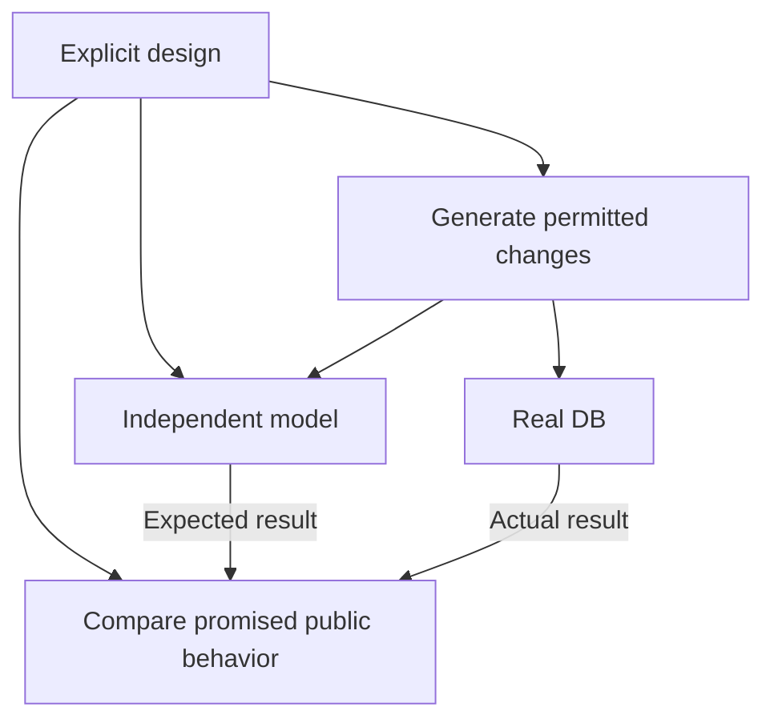

I'm delighted to announce on behalf of the core DB maintainers, myself, Sam Willis, Kevin De Porre, and the entire TanStack community—TanStack DB 1.0 RC1 is here!

After 1.5 years of development and betas and many discussions with users, the API is powerful, production-ready, and stable.

If you're upgrading an existing app, see the [1.0 RC migration guide](https://tanstack.com/db/latest/docs/guides/migrate-to-1-0-rc) for package updates and breaking API changes.

Since our [0.6 release](https://tanstack.com/blog/tanstack-db-0.6-app-ready-with-persistence-and-includes), we’ve shipped [server rendering and deep integration with TanStack Start](https://tanstack.com/db/latest/docs/guides/ssr), added collection adapters for [Neon Realtime](https://neon.com/docs/realtime/overview) and [Convex](https://github.com/TanStack/db/pull/2230), and expanded framework support to include [Preact](https://github.com/TanStack/db/pull/2235), our sixth framework adapter. We’ve fixed an enormous number of bugs while hardening DB for 1.0—and made it much faster and smaller along the way.

DB is built for demanding applications, and making its ambitious API fully production-ready has been my main focus over the past few months. Here’s how we’ve done that, what we’ve learned, and why I’m excited about where it leads:

1. [From unit tests to oracles](#from-unit-tests-to-oracles): what oracles are and why I'm so excited about them
2. [Hardening DB for 1.0](#hardening-db-for-10): how we're finding bugs and making DB epically production-ready
3. [Crafting a playable environment for agents](#crafting-a-playable-environment-for-agents): how DB's design knowledge helps agents make better decisions
4. [A recipe for designing an oracle](#a-recipe-for-designing-an-oracle): how to build an oracle and connect it to formal verification
5. [Look for cranes](#look-for-cranes): why the tools around coding agents make them more effective
6. [Superhistory](#superhistory): how agents change programming's pace and economics while accelerating software maturity
7. [The world DB creates for your agents](#the-world-db-creates-for-your-agents): how frameworks can guide agents toward better application code

If you haven't used it yet, TanStack DB is a reactive client data framework that makes backend data feel local. Records from your API or sync engine become typed collections. Components query them for joined, filtered live results. Optimistic edits appear immediately and reconcile with the server later.

Perhaps the biggest difference between TanStack DB and earlier client-side databases is that you can adopt TanStack DB features incrementally. Historically, getting reactive queries, optimistic mutations, and offline support often meant adopting a new database and sync architecture. With TanStack DB, you can start with your existing REST APIs and [TanStack Query](https://tanstack.com/query/latest) setup, immediately gain fast incremental relational queries, and progressively add [local persistence](https://tanstack.com/db/latest/docs/guides/sqlite-persistence), [durable offline mutations](https://tanstack.com/db/latest/docs/guides/offline-transactions), or real-time sync as needed. Because the application-facing query model stays the same, you can go from a conventional web application to a fully offline-capable, local-first app without rewriting everything along the way.

We began building DB in early 2025 at [ElectricSQL](https://electric-sql.com/), which incubated the project for its first year and a half. Since [Neon acquired us in August](https://neon.com/blog/electrifying-neon-building-the-realtime-backend), it has continued to back DB and we recently released [Neon Realtime](https://neon.com/docs/realtime/overview) with [TanStack DB support](https://neon.com/docs/realtime/sdks/typescript#tanstack-db).

Adoption is accelerating, with teams using TanStack DB to build everything from developer tools to consumer mobile apps. Prisma uses DB in [Prisma Studio](https://github.com/prisma/studio), its open-source database editor. Unkey uses it extensively across its [developer dashboard](https://github.com/unkeyed/unkey/tree/main/web/apps/dashboard), and Skylight uses DB and its offline capabilities in its [React Native family calendar app](https://www.youtube.com/watch?v=HSUKoa4JoRw).

The core `@tanstack/db` package now gets [over a million weekly npm downloads](https://www.npmjs.com/package/@tanstack/db). DB adoption has grown roughly 10× over the past year (using [weekly core-package downloads relative to React’s](https://tanstack.com/stats/npm?packageGroups=%5B%7B%22packages%22%3A%5B%7B%22name%22%3A%22%40tanstack%2Fdb%22%7D%5D%7D%2C%7B%22packages%22%3A%5B%7B%22name%22%3A%22react%22%2C%22hidden%22%3Atrue%7D%5D%2C%22color%22%3A%22%2361DAFB%22%2C%22baseline%22%3Atrue%2C%22baselineLabel%22%3A%22React%22%7D%5D&range=1825-days&transform=none&binType=weekly&viewMode=history&chartType=line&barSort=value&bucketOffset=0&playbackIntervalMs=350&playbackLoop=false&playbackPlaying=false&showDataMode=all&normalizeBaseline=true&showBaseline=false&showLegend=false&height=400) as a proxy, now about 0.6%).

After server rendering landed a few months ago, I thought the remaining work before 1.0 was fairly straightforward: fix every known bug. I'd fire up my agents and set them loose and be done in a few weeks. Before and during that work, though, I tried some new ideas for making the coding environment more productive for agent swarms. The new environment has proved astonishingly effective at finding new bugs and undefined behavior. My short bug-fixing expedition has now stretched to hundreds of PRs and months of intense work hardening DB's core abstractions for 1.0. Since the first PR in this push, the repository has gained roughly 420,000 lines of tests.

I've worked on open-source libraries for a long time and previously found it hard to find bugs proactively before users provide reproductions. Now essentially every new agent session stumbles on multiple new classes of bugs. Many of these bugs are now so obscure that I suspect no one has encountered them in the wild. Yet they keep coming. Increasingly, my job is to keep agents from fixing _too much_—chasing hypothetical edge cases or adding complexity to solve problems DB didn't intend to solve.

## From unit tests to oracles

A [test oracle](https://en.wikipedia.org/wiki/Test_oracle) is an established concept in software testing: something that tells you what the correct behavior should be. It might be a known answer, a simple reference model, or another trusted system.

I’m using oracle models to make DB’s design executable: to express what it should do in a form I can run, challenge, and verify the production code against. I’ll show how to turn an ordinary unit test into an oracle, step by step, and what we gain along the way.

A conventional unit test records the expected result for a particular example: give a sorting function `[3, 1, 2]` and verify that it returns `[1, 2, 3]`. I choose the input and supply the answer.

The first step to oracles is adding **property-based testing**: generalize from individual examples to rules. A sorting function should return exactly the original elements in ascending order. A generator produces thousands of inputs—empty lists, repeated values, negative numbers, long lists—and the test verifies that rule for each one.

The generator supplies examples, but I still have to supply the rules. For a library like DB, that means spelling out which actions are allowed, how they change the data, and what its users should observe. Building a useful generated test becomes a way of working out and expressing the subsystem’s design.

Consider this live query over a collection of tasks:

```ts
const topTasks = createLiveQueryCollection((q) =>
  q
    .from({ task: tasks })
    .where(({ task }) => eq(task.completed, false))
    .orderBy(({ task }) => task.priority, 'desc')
    .orderBy(({ task }) => task.id, 'asc')
    .limit(10),
)
```

The query selects up to ten open tasks: highest priority first and breaking ties by ID. DB must maintain the result defined by those clauses as the source records change. Completing a selected task removes it and brings the next eligible task into the window. Raising another task’s priority can move it into the window and displace one already there. Once DB has processed a batch of changes, the published rows and their order must match that query.

We can express parts of that promise as PBT rules: no completed tasks, correct ordering, at most ten rows. But an empty result would satisfy all three. The full rule is stronger: **the result must contain exactly the tasks selected by the query, in the right order, after every batch of changes.**

A small model makes that rule executable. It keeps the task records in a plain JavaScript `Map`, applies the requested changes, then filters out completed tasks, sorts by priority and ID, and takes the first ten. Instead of supplying an expected answer for each example, I’ve written down how to calculate the answer for any example. That independent model is our **oracle**.

DB uses complex machinery to maintain the results efficiently. The model recomputes everything from scratch. It trades efficiency for simplicity, making the expected behavior straightforward to understand and inspect.

Now property-based testing can verify the full rule across generated histories: **DB’s result must match the model’s answer.** The generator varies the starting records and sequences of supported inserts, updates, and deletes, applied individually or in batches. The test gives the same changes to the model and DB, then compares the live query’s public rows and their order with the model’s answer after each batch.



An oracle can also draw on an established system’s understanding. For server-to-client synchronization, Postgres can supply the reference: make changes in Postgres, let them synchronize, and require the client’s corresponding rows and values to match Postgres exactly. We can build on existing abstractions instead of writing every reference computation ourselves.

We’re phasing out standalone example-based tests in DB, and we’ll soon lint against adding them. Fixing a reported bug is only the beginning. We encode the design rule it exposed, then explore the whole category of cases that rule governs. **An isolated test preserves an answer. An oracle preserves the understanding that produces the answers.** I no longer want agents stopping at a passing reproduction.

**The model turns the design into an answer key for cases we didn't write out by hand.**

The model can happily filter and sort every task after every change. Production has to avoid that work. This lets us investigate what DB should do separately from engineering how to do it efficiently. An agent can replace the query algorithm, introduce an index, or delete a pile of bookkeeping while the oracle verifies that the promised behavior survives.


## Hardening DB for 1.0

A mature library has answers to questions its authors didn’t initially know to ask. Users combine features in unexpected ways; maintainers fix the bugs and resolve the ambiguities those combinations expose. Years of that work turn a promising API into something applications can depend on.

The task query above shows why DB’s maturation is particularly demanding. Completing one task can mean fetching the next task from the server. Now make that edit offline, preserve it across an app restart, and reconnect after the server’s data has changed. What should the screen show along the way? What must DB retain, fetch, and reconcile?

Oracles let me explore that design space dramatically faster, without waiting for users to discover each failure. Let's look at the history of a few of these oracles that cover collection data updates to see how the exploration oracles enable builds on itself.

### How the oracles got stronger

Collections notify other code—their subscribers—about changes with insert, update, and delete messages. A user [reported a bug](https://github.com/TanStack/db/issues/1901) where they deleted a row and reinserted a replacement with the same key in one turn. DB sent the subscriber a delete for the row but no later insert message to put it back. A direct read returned the replacement, but replaying the collection messages left the subscriber's cache without the reinserted row.

[PR #1902](https://github.com/TanStack/db/pull/1902) fixed the immediate failure and added an oracle for the broader promise: **a subscriber applying every change message should end up with the same rows as a direct read.**

The oracle has three parts: a small reference model, a real DB collection, and a subscriber listening to that collection. The model applies the requested writes to a plain JavaScript `Map`, calculating which rows should exist. DB receives the same writes. The subscriber maintains its own map, updated only through the insert, update, and delete messages DB sends it. This lets us verify both that DB stores the right rows and that its messages give subscribers enough information to reconstruct them.

The oracle constructs histories of writes, exploring that promise from several directions:

- Start empty, with one row already present, or with two rows present.
- Insert, update, delete, and reinsert the same key; interleave writes to different keys. Give each inserted or updated row a distinct value so stale data is visible.
- Issue writes back-to-back before waiting for them to finish, or let each write finish before starting the next.
- Enumerate every legal short sequence: up to four writes on one initially absent key, or three writes on two keys from every starting combination.
- Generate longer histories—up to twenty writes across four keys—with both a fixed seed for repeatable coverage and fresh random seeds for further exploration.

After each completed write or group of writes, the oracle compares the model’s expected rows, a direct read from DB, and the subscriber’s reconstructed rows. All three should agree. Whenever DB delivers a batch of messages, it also verifies that applying those messages leaves the subscriber with the same rows DB currently exposes. In the original failure, the model and DB held the replacement row, but DB’s messages left the subscriber’s map empty.

Later, an agent challenged the oracle by deliberately changing how DB chose between insert and update messages. The oracle accepted both versions, even though they sent different messages for the same history. Investigating that disagreement revealed a bug in production—and a blind spot in the oracle. After a subscriber had removed a deleted row, a sync commit made the same key visible again. DB remembered the earlier optimistic operation and sent an **update**. But the subscriber no longer had that row. It needed an **insert**.

The oracle hid the mistake. Its simulated subscriber used JavaScript’s `Map.set` for both inserts and updates, so the invalid update recreated the missing row. The expected rows, direct reads, and subscriber’s reconstructed rows all agreed. I made the oracle enforce what each message means: **insert requires an absent key; update and delete require a present key.** Without adding any histories, 26 of the existing 378 cases failed. [PR #1995](https://github.com/TanStack/db/pull/1995) removed the branch that chose an update for a previously absent key. The code became smaller, and all 378 cases passed.

Another gap surfaced during a review of [PR #2004](https://github.com/TanStack/db/pull/2004). While a local optimistic edit was active, a server refresh replaced the collection’s source rows. DB sent **delete → insert → insert** for the same key. DB assembled the outgoing messages in two stages. First, it restored the row with its pending optimistic edit and added an insert message. Later, while processing the server’s replacement rows, it added another insert for the same row. The duplicate-removal step ran between those stages, before the second insert existed, so it removed nothing.

A separate oracle already explored server refreshes during optimistic edits. But its subscriber requested both the initial rows and later changes. In that mode, DB tracks which rows it has already delivered and filters repeated inserts. The duplicate disappeared before the oracle could inspect it. Meanwhile, the strict subscriber from #1995 could recognize the invalid message but never exercised server refreshes.

In [PR #2005](https://github.com/TanStack/db/pull/2005), I extended the oracle to exercise DB’s other subscription mode: receive only future changes, without that filtering. I initialized this subscriber’s map from the independent model, then verified every incoming message and compared its reconstructed rows with the model after each history step. The old implementation failed seven cases. The production fix stopped generating the duplicate insert; the filtering remained unchanged.

The stronger oracle then found another duplicate insert during a random run, without any server replacement. A delete succeeded, a new optimistic insert restored the same key, and a later sync commit finished clearing away the old delete. That cleanup forgot the subscriber had already seen the new row and announced it again. The same message rule caught a different route to the failure.

The original report was fixed in #1902. Each subsequent investigation clarified what a subscriber should receive or exposed a weakness in how we verified it.

The same iterative design process is happening across DB’s oracles: finding production bugs, closing gaps in coverage, discovering missing laws, and correcting mistaken assumptions in the models themselves. Each oracle develops a more precise account of its small part of DB. The design and the instruments for verifying it mature together, with each discovery preserved for every later change.

## Crafting a playable environment for agents

An agent reading DB's implementation can see what it does today. To make good changes, it needs to understand which behaviors are promises, which are accidents, and where we still need to decide what DB should do.

This work to build oracles has been reshaping DB's repository into a "playable" environment where fresh agents can find those design decisions, experiment, and get clear feedback. Each oracle controls a small part of DB's intended behavior, with the reasoning behind its rules written beside the model.

DB now has **211 oracle test files across 15 packages**, covering things like [the messages sent when data changes](https://github.com/TanStack/db/blob/main/packages/db/tests/change-event-history-oracle.test.ts), [how queries assemble related records](https://github.com/TanStack/db/blob/main/packages/db/tests/query/includes-cross-formulation-oracle.property.test.ts), and [which rows pagination returns](https://github.com/TanStack/db/blob/main/packages/query-db-collection/tests/cursor-pagination.oracle.test.ts). The repository's [coverage map](https://github.com/TanStack/db/blob/main/docs/contributing/oracle-coverage.md) helps agents find the relevant oracle.

An agent working on a change will often run afoul of an oracle and get told its design is wrong. It then reads the oracle carefully to understand the design it needs to respect and revises its approach. The failure directs it to the relevant model, a concrete counterexample, and the reasoning behind the rule. Hours of earlier design work become available when needed, without requiring every fresh agent to absorb the entire design upfront.

Design that can talk back.

## A recipe for designing an oracle

Here's how I build one with my agents:

1. **Choose one precise promise.** State what someone using the software should observe, and when. This is the oracle's law. Resolve ambiguous cases explicitly: the task query above breaks ties between equal-priority tasks by ID. Record why you chose the rule and what assumptions it depends on, so later agents can recognize when the decision needs revisiting.

2. **Calculate the answer independently.** Derive it from the promise. Reusing production's algorithms or helpers can reproduce the same mistake on both sides and leave the oracle happily agreeing with broken code.

3. **Choose where and when to observe production.** Compare the behavior at the moment the promise applies. For the collection oracle, that meant observing raw messages as subscribers received them, alongside the final rows.

4. **Generate meaningful sequences.** Vary the data, operation order, and relevant timing. This draws on property-based testing and fuzzing (we use [fast-check](https://fast-check.dev/) extensively). Fast-check also shrinks failures into short counterexamples, making an otherwise bewildering failure practical to investigate.

5. **Try to fool the oracle.** Deliberately break a rule in the implementation and verify that the oracle rejects it for the intended reason. Ask a hostile reviewer—an agent tasked with finding holes—which wrong designs could still pass.

6. **Diagnose disagreements before changing expectations.** The implementation might violate the promise, the model might misstate it, or the promise itself might need redesign. Work out which account failed before deciding what to repair. Keep the shortened failing sequence as a regression case beside the model.

I've written and heavily iterated on [oracle-authoring](https://github.com/TanStack/db/blob/main/.agents/skills/oracle-authoring/SKILL.md) and [oracle-review](https://github.com/TanStack/db/blob/main/.agents/skills/oracle-review/SKILL.md) SKILLs, plus a rigorous [14-part rubric](https://github.com/TanStack/db/blob/main/docs/contributing/oracle-rubric.md) that agents use to evaluate and improve their oracles.

### How this relates to formal verification

The oracle’s model is an **executable specification**. For difficult designs, I often develop that specification first in [TLA+](https://lamport.org/tla/tla.html), a language used in formal verification. A TLA+ model checker can explore every allowed ordering of operations within a bounded model. Can an obsolete request overwrite a newer result? Can releasing one subscription cancel work another still needs? Can a sequence of valid operations leave the system stuck? A counterexample gives me the exact sequence where a proposed rule fails, so I can investigate what the design needs to change.

I then translate the model into a TypeScript oracle that runs against DB. TLA+ tests whether the modeled design preserves its stated rules; the oracle tests whether the actual implementation follows that design across generated histories.

## Look for cranes

The oracles I’ve described are examples of what Daniel Dennett calls **cranes**: mechanisms that make more of a design space reachable.

In Daniel Dennett's [_Darwin's Dangerous Idea_](https://www.simonandschuster.com/books/Darwins-Dangerous-Idea/Daniel-C-Dennett/9780684824710), Dennett chronicles Darwin's startling claim that natural selection, with no foresight, could produce eyes, brains, and other astonishingly intricate adaptations. Many people doubted that a blind process could do this and looked for an outside intelligence to supply the design, an explanatory move Dennett calls a **skyhook**: it lowers the finished complexity into place from above like the _deus ex machina_ of Greek theater, where stage machinery lowers a god to resolve the plot.

Dennett contrasts this with **cranes**—construction cranes. Both skyhooks and cranes lift, but a crane works from existing designs. It helps you reach upwards to build a new layer. Once that layer is built, it can support new cranes that reach higher and build further layers. In evolution, cranes make more possibilities accessible to variation and selection. Sexual reproduction, for example, recombines inherited variants, letting selection work on combinations that mutation in a single lineage would reach much more slowly.


The skyhook story in agentic programming is that a sufficiently intelligent model, given a repository, will infer every unstated rule and deliver the right system in one leap. One-shot coding makes that easy to believe for familiar tasks. Those successes stand on compilers, libraries, conventions, and a vast history of solved problems in the model's training. Much of the design work has already been done.

Every substantial software project runs into questions that software history hasn't settled. Features interact in unexpected ways; new uses reveal missing guarantees. More intelligence cannot reconstruct a decision we haven't made or captured. The work is to search the design space, decide what should hold, and test candidate answers.

**Oracles are cranes for my agents.** They make ambitious changes practical: an agent can replace complicated machinery while an independent model verifies the behavior it must preserve. Generators extend that reach by exploring combinations the agent hasn’t thought to try. Hostile reviews strengthen the oracles themselves, and benchmarks help select implementations that improve performance. These are the mechanisms I’ve been accumulating around the models to make their search through DB’s design space more productive.

I also shape the _fitness landscape_—the constraints and feedback that favor some candidates over others—by editing [AGENTS.md](https://github.com/TanStack/db/blob/main/AGENTS.md). For example, I tell agents to prefer fixes that remove production code.

The oracles help agents reach further and give that progress a ratchet. Once a design decision is captured and enforced by an oracle, it stays locked in. The regressions I still find expose assumptions the oracles weren’t testing. Agents can radically rework the implementation without losing the design knowledge we’ve already established. Each investigation starts from a firmer platform, reaches another ambiguity, and locks in another piece of the design.

The work has taken three months and many billions of tokens. Each investigation leaves later agents with sharper instruments. These changes in their working environment have mattered far more than any model upgrade I've seen.

## Superhistory

Coding agents equipped with those instruments can compress what used to be weeks of work into an afternoon. Venkatesh Rao calls this agent-mediated compression of experience [“artificial time”](https://contraptions.venkateshrao.com/p/superhistory-not-superintelligence). I spend much of the day in what feels like a succession of intense design meetings, with fresh evidence arriving 100x faster than I could have gathered it myself.

I’m speedrunning DB through the software maturation process. Oracles let agents explore huge stretches of design space, uncovering failures and unresolved design questions that would normally emerge over years of use. Interactions between synchronization, optimistic edits, persistence, and queries get investigated long before a user happens upon that particular combination. Working through those discoveries is giving DB years of maturation in months.

Programming has become more intellectually demanding for me even as writing the code has become cheaper.

When an idea would take weeks to investigate, I need a strong reason to try it. With agents and an oracle, I can afford to take a much less certain idea far enough to find out whether it works. That changes which designs I can explore.

Rigorous engineering is much cheaper now. Oracles have always worked incredibly well, but they're demanding to write and very verbose. In the months spent preparing DB for 1.0, the repository has gained roughly 420,000 lines of tests—probably more code than I wrote in my entire life before AI. Agents make that work practical.

## The world DB creates for your agents

Frameworks give application code a simpler world to operate in. DB lets you query backend data and edit it as though it were local, while handling the complicated coordination underneath. The design decisions I’ve described become problems your application doesn’t have to solve again.

With coding agents, that accumulated understanding can do more. Frameworks, infrastructure, and developer tools can help guide how applications get written. [SKILLs](https://agentskills.io/home) are a first step: DB can explain its abstractions and guarantees to an agent as it works. I think we can go a lot further and give your agents executable models and instruments they can use to develop and verify their designs.

An agent building a custom collection could use a DB oracle to discover where its sync behavior breaks down. An agent making a screen faster could experiment with loading strategies, measuring query latency and data transferred while verifying that the results stay correct. The design knowledge accumulated while hardening DB would become something your agents can actively work with—helping translate your intent into optimal application code.

### From server functions to live collections

The instruments built while hardening DB also make more ambitious abstractions practical to pursue. One idea I'm exploring is to let you write ordinary server functions to query and mutate Postgres, then have DB compile them into the collections and actions for your clients and server code for your API.

```tsx
// Server: define a query
const todos = query({
  async handler(req, res) {
    return res.json(await db.select().from(todo))
  },
})

// Server: define a mutation
const addTodo = mutation({
  async handler(req, res) {
    return res.json(await db.insert(todo).values(req.body).returning())
  },
})

// Client: use the generated collection and action
const { data } = useLiveQuery(todos)
addTodo({ id: crypto.randomUUID(), text: 'Hello world' })
```

_Simplified sketch of an experimental API._

In this design, DB also generates the data-loading and mutation wiring. When a mutation runs, the client tells the server which query collections are live. The server determines which need updating and returns fresh results with the mutation response.

Making this work across a wide range of Postgres queries means understanding enough of the language to preserve query meaning, determine which reads a write affects, and reconcile client state correctly. A few years ago, I wouldn't have considered attempting this hugely ambitious API. But the learnings of the last few months make it feel tractable enough to pursue.

### Software that gets better at getting better

There's a useful name for what these cranes I've added to the codebase improve: _evolvability_, a system's capacity to support further useful development. Autonomy asks how much work an agent can do without me. Evolvability asks what new work becomes possible because of what we've learned. An agent arriving tomorrow can attempt something more ambitious using the same LLM because it inherits better cranes.

That's what makes me excited about where programming is going: the possibility of much more robust, delightful, and varied software, including ideas that used to cost too much to pursue.

[Try out our 1.0 RC](https://tanstack.com/db/latest/docs/quick-start) in a demanding application and let us know how it goes.
