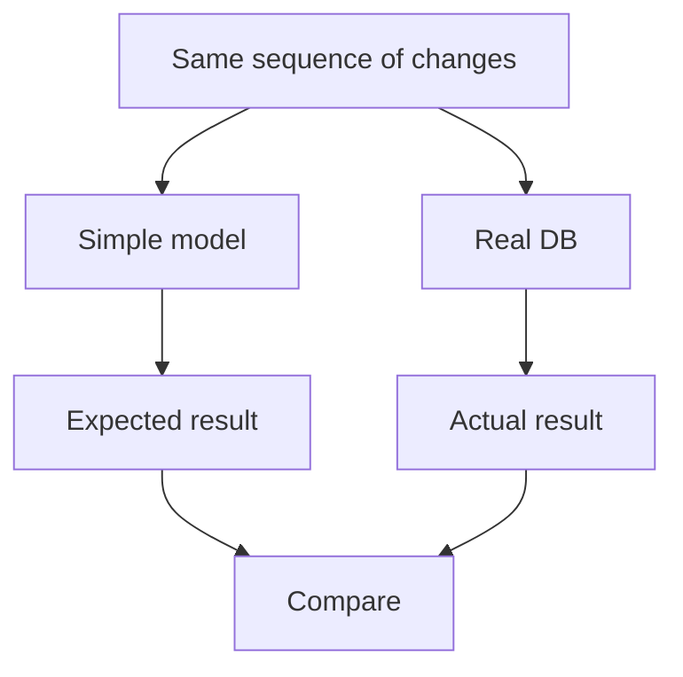

I'm delighted to announce on behalf of the core DB maintainers, myself, Sam Willis, Kevin De Porre, and the entire DB community, that TanStack DB 1.0 RC1 is here!

After 1.5 years of development and betas and many discussions with users, the API is powerful and stable. We expect to ship 1.0 in a few short weeks.

Since our [0.6 release](https://tanstack.com/blog/tanstack-db-0.6-app-ready-with-persistence-and-includes), we have shipped [server rendering and deep integration with TanStack Start](https://tanstack.com/db/latest/docs/guides/ssr), worked through a long run of correctness problems closing every known bug, added new collection adapters for Neon Realtime and Convex, and [made DB much faster for applications with many simultaneous live queries](https://github.com/TanStack/db/pull/1987).

After a quick introduction to DB and this release, the post has eight sections:

1. [From unit tests to oracles](#from-unit-tests-to-oracles): what an oracle is and how it helps explore whole categories of bugs.
2. [Crafting a playable environment for agents](#crafting-a-playable-environment-for-agents): making DB's design knowledge available to coding agents.
3. [The bug list kept growing](#the-bug-list-kept-growing): what I did and learned while making DB epically production ready.
4. [A recipe for designing an oracle](#a-recipe-for-designing-an-oracle): how to build one, and how it relates to formal verification.
5. [Look for cranes](#look-for-cranes): why the tools around a coding agent matter so much.
6. [Superhistory](#superhistory): how agents change the pace and economics of programming.
7. [Drawing out the design](#drawing-out-the-design): how agents help develop and refine DB's design.
8. [The world DB creates for your agents](#the-world-db-creates-for-your-agents): what this means for frameworks and application developers.

If you haven't used it yet, TanStack DB is a reactive client data framework that makes backend data feel local. Records from your API or sync engine become typed collections. Components query them for joined, filtered live results. Optimistic edits appear immediately and reconcile with the server later.

Perhaps the biggest difference between TanStack DB and from earlier client-side databases is that you can adopt TanStack DB incrementally. Historically, getting reactive queries, optimistic mutations, and offline support often meant adopting a new database and sync architecture. With TanStack DB, you can start with your existing REST APIs and [TanStack Query](https://tanstack.com/query/latest) setup, immediately gain fast incremental relational queries, and progressively add [local persistence](https://tanstack.com/db/latest/docs/guides/sqlite-persistence), [durable offline mutations](https://tanstack.com/db/latest/docs/guides/offline-transactions), or real-time sync as your needs evolve. Because the application-facing query model stays the same, you can go from a conventional web application to a fully offline-capable, local-first app without rewriting everything along the way.

We began building DB in early 2025 at [ElectricSQL](https://electric-sql.com/), which incubated the project for its first year and a half. We [shipped the first beta that July](https://tanstack.com/blog/tanstack-db-0.1-the-embedded-client-database-for-tanstack-query). Since [Neon acquired us in August](https://neon.com/blog/electrifying-neon-building-the-realtime-backend), it has continued to back DB and we recently released [Neon Realtime](https://neon.com/docs/realtime/overview) with [TanStack DB support](https://neon.com/docs/realtime/sdks/typescript#tanstack-db).

Adoption is accelerating, with teams using TanStack DB to build everything from developer tools to consumer mobile apps. Prisma uses DB in [Prisma Studio](https://github.com/prisma/studio), its open-source database editor. Unkey uses it extensively across its [developer dashboard](https://github.com/unkeyed/unkey/tree/main/web/apps/dashboard), and Skylight uses DB and its offline capabilities in its [React Native family calendar app](https://www.youtube.com/watch?v=HSUKoa4JoRw).

Across its packages, DB now has [almost 3 million weekly NPM downloads](https://tanstack.com/db/latest). Compared to [weekly downloads of React](https://tanstack.com/stats/npm?packageGroups=%5B%7B%22packages%22%3A%5B%7B%22name%22%3A%22%40tanstack%2Fdb%22%7D%5D%7D%2C%7B%22packages%22%3A%5B%7B%22name%22%3A%22react%22%2C%22hidden%22%3Atrue%7D%5D%2C%22color%22%3A%22%2361DAFB%22%2C%22baseline%22%3Atrue%2C%22baselineLabel%22%3A%22React%22%7D%5D&range=1825-days&transform=none&binType=weekly&viewMode=history&chartType=line&barSort=value&bucketOffset=0&playbackIntervalMs=350&playbackLoop=false&playbackPlaying=false&showDataMode=all&normalizeBaseline=true&showBaseline=false&showLegend=false&height=400), downloads of the core DB package have grown roughly tenfold over the past year, to about 0.7% of React's downloads.

After server rendering landed a few months ago, I thought the remaining work before 1.0 was fairly straightforward: fix every known bug. I'd fire up my agents and set them loose and be done in a few weeks. Before and during that work, though, I tried some new ideas for making the coding environment more productive for agent swarms. The new environment has proved astonishingly effective at finding new bugs and undefined behavior. My short bug-fixing expedition has now stretched to hundreds of PRs and months of intense work hardening DB's core abstractions for 1.0. Since the first PR in this push, the repository has gained roughly 330,000 lines of tests.

I've worked on open-source libraries for a long time and previously found it hard to find bugs proactively before users provide reproductions. Now essentially every new agent session stumbles on multiple new classes of bugs. Many of which are now so obscure that I suspect no one has encountered them in the wild. Yet they keep coming. Increasingly, my job is to keep agents from fixing _too much_—chasing hypothetical edge cases or adding complexity to solve problems DB never promised to solve.

## From unit tests to oracles

Every software test needs something to try and a way to tell whether the result is right. That second part—the answer key—is called an **oracle**.

In a typical unit test, I write down a specific example and its expected result: start with three open tasks, mark one complete, and check that the list contains the other two. That expected list is the oracle for that test. I supply the answer by hand.

The model-based oracles I'm using calculate expected answers for many different examples. Suppose a screen shows the ten highest-priority open tasks. DB's production code uses complex machinery to keep that list current efficiently as tasks change. The model trades efficiency for simplicity: take all the tasks, remove the completed ones, sort by priority, and take the first ten. It rebuilds the whole answer from scratch after every change—a few straightforward lines of code can describe what a much more complex implementation should produce.

Give the model and DB the same changes, then compare their results. The simple model becomes an independent answer key for the optimized production code.



The answer key can come from a small model I write or an existing tool that's already been thoroughly tested. A built-in JavaScript `Map` can track which keyed rows should exist after a sequence of inserts, updates, and deletes. SQLite can tell us what a query should return—I've used it to validate DB's query behavior. In each case, we have an independent way to calculate the expected answer and compare it with production.

Now agents can automatically try thousands of sequences—adding tasks, changing priorities, completing and reopening them—while the model calculates the answer after each change. A reported bug becomes the starting point for exploring a whole category of failures: different starting data, different changes, different orders.

**The model gives us an answer key for cases we never wrote out by hand.**

## Crafting a playable environment for agents

An agent reading DB's implementation can see what it does today. To make good changes, it also needs to understand which behaviors are promises, which are accidents, and why I chose one rule over another.

I've been reshaping DB's repository into a "playable" environment where fresh agents can find those design decisions, experiment, and get clear feedback. Each oracle captures a small part of DB's intended behavior, with the reasoning behind its rules written beside the model.

I use one recurring loop to develop that understanding: start with a bug report or design question and work out the rules for the whole class of cases:

- Which actions are allowed, and which should be rejected?
- What should a user see after each action, and when?
- What should happen if actions overlap, fail, or arrive in a different order?

I encode that reasoning in the oracle's model, turning the design decisions into precise, executable rules the codebase must satisfy. Then agents search for counterexamples and verify their fixes against those rules across generated cases. The goal is to fix the entire class of bugs, with the model continuing to enforce the design as the codebase changes.

I make the product decisions; agents do much of the searching.

DB now has **176 oracle test files across 15 packages**, covering [the messages sent when data changes](https://github.com/TanStack/db/blob/main/packages/db/tests/change-event-history-oracle.test.ts), [how queries assemble related records](https://github.com/TanStack/db/blob/main/packages/db/tests/query/includes-cross-formulation-oracle.property.test.ts), and [which rows pagination returns](https://github.com/TanStack/db/blob/main/packages/query-db-collection/tests/cursor-pagination.oracle.test.ts), among other behaviors. The repository's [coverage map](https://github.com/TanStack/db/blob/main/docs/contributing/oracle-coverage.md) helps agents find the relevant oracle.

An agent working on a change will often run afoul of an oracle and get told its design is wrong. It then reads the oracle carefully to understand the design it needs to respect and revises its approach. Hours of earlier design work guide a later agent at the moment it needs that understanding.

Design that can talk back.

## The bug list kept growing

No software survives contact with reality. Software becomes battle-tested when many people use it in different ways and maintainers fix what those uses reveal. That maturation normally takes years.

For DB, becoming battle-tested means making the promise that backend data feels local hold up under all those different uses. Components query collections for live results, and edits appear immediately. Behind that simple experience, DB coordinates records arriving from the server, changes made on the client, and updates to what's on screen.

Loading data a page at a time, saving it across restarts, and supporting offline edits make that coordination much harder. An application can restart with an edit still waiting to reach the server. If a screen has loaded only the ten highest-priority open tasks, completing one means fetching the next task from the server. Each feature introduces more interactions that need to work correctly together. The application still uses the same simple API, but making that abstraction reliable becomes an immense testing problem.

### How one oracle got stronger

Collections notify other code—their subscribers—about changes with insert, update, and delete messages. A user [reported a bug](https://github.com/TanStack/db/issues/1901) where they deleted a row and reinserted a replacement with the same key in one turn. A direct read returned the replacement, but a subscriber replaying the messages could end with no row at all. An application maintaining a cache from those messages could lose data.

[PR #1902](https://github.com/TanStack/db/pull/1902) fixed the immediate failure and added an oracle for the broader promise: **a subscriber applying every change message should end up with the same rows as a direct read.** A plain map of keyed rows supplied the expected state. Across generated changes, applied individually and in batches, the oracle compared that state with both DB's direct reads and the rows a subscriber reconstructed from its messages.

Later, an agent tried removing branches from the collection code to see which ones the tests actually needed. One removal produced a better change message, yet both the old and new code passed the oracle. Its simulated subscriber treated an **insert** and an **update** as the same map operation. An update could recreate a row the subscriber had already deleted. The final rows looked right, even though a real subscriber that updates only existing rows would reject the message or lose the replacement.

I strengthened the rule: **insert requires an absent key; update and delete require a present key.** The old code then failed 26 of 378 histories already reaching that path. [PR #1995](https://github.com/TanStack/db/pull/1995) made DB send an insert when the key became visible again. Agreement on final rows was no longer enough; every message had to be valid when received.

A review exposed another gap. While reviewing [PR #2004](https://github.com/TanStack/db/pull/2004), CodeRabbit found that replacing the server's source rows during an optimistic edit could send **two inserts for the same key**. The oracle already knew that was wrong, but the subscriber used by the test filtered out the second insert before the oracle saw it.

For [PR #2005](https://github.com/TanStack/db/pull/2005), an agent added a subscriber initialized with the current visible rows that validated each raw message, then compared its reconstructed rows with the independent model after every batch. The old code failed seven cases. The fix published each key once, and the stronger oracle went on to find another invalid insert when a pending delete overlapped an optimistic insert. Changing what the oracle could observe exposed failures that had previously been invisible.

The original report was fixed in #1902. The later investigations required making the design more precise—and making the oracle capable of enforcing distinctions it had previously missed.

## A recipe for designing an oracle

Here's how I build one with my agents:

1. **Choose one precise promise.** State what someone using the software should observe, and when. This is the oracle's law. Resolve ambiguous cases: our task-list model needs a rule for ordering tasks with equal priority.

2. **Calculate the answer independently.** Derive it from the promise. Reusing production's algorithms or helpers can reproduce the same mistake on both sides and leave the oracle happily agreeing with broken code.

3. **Choose where and when to observe production.** Compare the behavior at the moment the promise applies. For the collection oracle, that meant observing raw messages as subscribers received them, alongside the final rows.

4. **Generate meaningful sequences.** Vary the data, operation order, and relevant timing. This draws on property-based testing and fuzzing (we use [fast-check](https://fast-check.dev/) extensively). Fast-check also shrinks failures into short counterexamples, making an otherwise bewildering failure practical to investigate.

5. **Try to fool the oracle.** Deliberately break a rule in the implementation and verify that the oracle rejects it for the intended reason. Ask a hostile reviewer—an agent tasked with finding holes—which wrong designs could still pass.

6. **Diagnose disagreements before changing expectations.** The implementation might violate the promise, the model might misstate it, or the promise itself might need redesign. Work out which account failed before deciding what to repair. Keep the shortened failing sequence as a regression case beside the model.

I've written and heavily iterated on [oracle-authoring](https://github.com/TanStack/db/blob/main/.agents/skills/oracle-authoring/SKILL.md) and [oracle-review](https://github.com/TanStack/db/blob/main/.agents/skills/oracle-review/SKILL.md) SKILLs, plus a rigorous [14-part rubric](https://github.com/TanStack/db/blob/main/docs/contributing/oracle-rubric.md) that agents use to evaluate and improve their oracles.

### How this relates to formal verification

For difficult designs, I often start in [TLA+](https://lamport.org/tla/tla.html), explore the consequences of proposed rules, then translate the model into a TypeScript oracle that runs against DB.

That model is an **executable specification**: a precise account of the intended behavior. This shares a foundation with [formal verification](https://www.anthropic.com/research/formal-verification). A formal proof, using a system such as [Lean](https://lean-lang.org/), establishes a specified property for all cases covered by its assumptions. Our generated tests exercise the actual implementation and compare its behavior with the specification.

## Look for cranes

In Daniel Dennett's [_Darwin's Dangerous Idea_](https://www.simonandschuster.com/books/Darwins-Dangerous-Idea/Daniel-C-Dennett/9780684824710), Dennett chronicles Darwin's startling claim that natural selection, with no foresight, could produce eyes, brains, and other astonishingly intricate adaptations. Many people doubted that a blind process could do this and looked for an outside intelligence to supply the design, an explanatory move Dennett calls a **skyhook**: it lowers the finished complexity into place from above like the _deus ex machina_ of Greek theater, where stage machinery lowers a god to resolve the plot.

Dennett contrasts this with **cranes**—construction cranes. Both skyhooks and cranes lift, but a crane works from solid support. It helps you reach upwards to build a new layer. Once that layer is built, it can support new cranes that reach higher and build further layers. In evolution, cranes make more possibilities accessible to variation and selection. Sexual reproduction, for example, recombines inherited variants, letting selection work on combinations that mutation in a single lineage would reach much more slowly.

The skyhook story in agentic programming is that a sufficiently intelligent model, given a repository, will infer every unstated rule and deliver the right system in one leap. One-shot coding makes that easy to believe for familiar tasks. Those successes stand on compilers, libraries, conventions, and a vast history of solved problems in the model's training. Much of the design work has already been done.

Every substantial software project runs into questions that history hasn't settled. Features interact in unexpected ways; new uses reveal missing guarantees. More intelligence cannot reconstruct a decision we haven't made or captured. The work is to search the design space, decide what should hold, and test candidate answers.

For my agent swarms, the cranes make that search productive. Oracles make candidate implementations cheap to try and incorrect behavior easier to reject. Hostile reviews strengthen the instruments doing the rejecting. Benchmarks tell me whether an implementation that preserves the behavior also improves performance. Together, these mechanisms let agents explore more ambitious changes and get useful feedback about which ones to pursue.

I also shape the _fitness landscape_—the constraints and feedback that favor some candidates over others—by editing [AGENTS.md](https://github.com/TanStack/db/blob/main/AGENTS.md). For example, I tell agents to treat every line of production code as a continuing cost and prefer fixes that remove code. This pushes them hard to avoid bloated and duplicative implementations.

The layering matters. A stronger oracle lets an agent attempt a change that would previously have been difficult to verify. That investigation can expose another missing distinction, which becomes part of the model and opens further possibilities. The cranes help build the next layer, which supports the next cranes.

The work has taken three months and many billions of tokens. Each investigation leaves later agents with sharper instruments. That change in their working environment has mattered far more than any model upgrade I've seen.

## Superhistory

Coding agents can compress what used to be weeks of work into an afternoon. Venkatesh Rao calls this agent-mediated compression of experience [“artificial time”](https://contraptions.venkateshrao.com/p/superhistory-not-superintelligence). I spend much of the day in what feels like a succession of intense design meetings, with fresh evidence arriving 100x faster than I could have gathered it myself.

Questions that normally accumulate across years are arriving in months. Implementation work clears quickly, leaving me in a steady stream of design decisions. I spend much more of my day deciding what DB should guarantee and whether a fix simplifies the system or adds unnecessary machinery. Programming has become more intellectually demanding for me even as writing the code has become cheaper.

When an idea would take weeks to investigate, I need a strong reason to try it. With agents and an oracle, I can afford to take a much less certain idea far enough to find out whether it works. That changes which designs I can explore.

Rigorous engineering is much cheaper now. Oracles work incredibly well, but they're demanding to write and very verbose. In the months spent preparing DB for 1.0, the repository has gained roughly 330,000 lines of tests—probably more code than I wrote in my entire life before AI. Agents make that work practical.

## Drawing out the design

Programmers have always drawn on accumulated design knowledge—recognizing parallels, adapting ideas, and discovering where they stop fitting. LLMs give coding agents a super fast search interface into that history. I use them to search a vast repertoire of algorithms and design ideas for things that fit DB's particular problems, then work through the adaptations those ideas need.

Design develops through many successive adaptations. Each decision has to fit what's already there, and its consequences reveal further questions to work through. An idea that solves one problem can expose a distinction we hadn't previously needed, or a conflict between two otherwise useful rules. Working through those decisions and distilling them into oracle models has become the bulk of programming for me.

Design is immensely complicated. Establishing or improving a single oracle can take hours of investigation between me and my agents: figuring out which distinctions matter, what the system should promise, and whether our model actually expresses that promise. A small executable model can embody a great deal of intellectual work. Together, those models embody an increasingly detailed theory of how clients should load, update, reconcile, and present data.

## The world DB creates for your agents

All this design work gives an agent building your application a simpler world to work in. It can join issues with projects, show one team's open work, and edit optimistically through DB's collections and live queries. DB keeps the results current and handles data loading, persistence, and synchronization, leaving you and your agents to focus on the behaviors you want to create.

Frameworks, infrastructure, and developer tools all do this: they embody detailed theories of their domains and make those domains easier to work in. Their APIs already shape applications. With coding agents, that knowledge can also guide how application code gets written. [SKILLs](https://agentskills.io/home) are a first step: they let a framework explain which abstractions to use, what those abstractions guarantee, and where the application has a decision to make.

For DB, I want to put that accumulated design knowledge in your agents' hands: oracles and other cranes that help them turn ambitious ideas into applications that hold up in practice. An agent building a custom collection should be able to run an oracle to verify that it syncs correctly. An agent tuning a screen should have instruments to optimize query loading speed and minimize data on the wire. You set the requirements; DB should work with your agents to translate your intent into optimal code.

### From server functions to live collections

The instruments built while hardening DB also make more ambitious abstractions practical to pursue. One idea I'm exploring is to let you write ordinary server functions to query and mutate Postgres, then have DB compile them into the collections and actions your client uses.

```tsx
// Server: define a query
const todos = query({
  async handler(req, res) {
    return res.json(await db.select().from(todo))
  },
})

// Server: define a mutation
const addTodo = mutation({
  async handler(req, res) {
    return res.json(await db.insert(todo).values(req.body).returning())
  },
})

// Client: use the generated collection and action
const { data } = useLiveQuery(todos)
addTodo({ id: crypto.randomUUID(), text: 'Hello world' })
```

_Simplified sketch of an experimental API._

In this design, DB also generates the data-loading and mutation wiring. When a mutation runs, the client tells the server which query collections are live. The server determines which need updating and returns fresh results with the mutation response.

Making this work broadly means understanding enough of Postgres's vast language to preserve query meaning, determine which reads a write affects, and reconcile client state correctly. A few years ago, I wouldn't have considered attempting the larger project. The work of the last three months has made it tractable enough to pursue.

### Building the next layer

There's a useful name for what these cranes improve: _evolvability_, a system's capacity to support further useful development. Autonomy asks how much work an agent can do without me. Evolvability asks what new work becomes possible because of what we've learned. An agent arriving tomorrow can attempt something more ambitious using the same LLM because it inherits better cranes.

My days are full of decisions about what matters, which promises to make, and when an investigation has gone far enough. Each answer can become part of the machinery that makes further development possible. That's what makes me excited about where programming is going: the possibility of much more robust, delightful, and varied software, including ideas that used to cost too much to pursue.

I began by trying to fix every known DB bug. TanStack DB 1.0 RC1 is the result so far. [Try it](https://tanstack.com/db/latest/docs/quick-start) in a demanding application and tell us [what breaks](https://github.com/TanStack/db/issues) or [what DB makes needlessly hard to build](https://github.com/TanStack/db/discussions).
